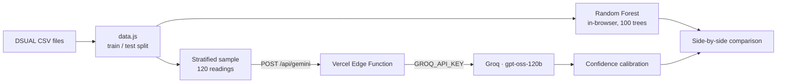

<div align="center">


# VEAM · Random Forest vs LLM

**Appliance recognition from electrical signatures: a supervised model against a zero-shot language model.**

[](https://veam-rf.vercel.app/)
[](#-academic-context)
[](#-method)
[](#-method)
[](#-architecture)

[**Open the demo**](https://veam-rf.vercel.app/) · [Method](#-method) · [Results](#-results) · [Limitations](#-limitations) · [Run locally](#-run-locally)

</div>

---

## ✨ Overview

This repository is the **evaluation companion of VEAM** (*Voltage Energy Analysis & Monitoring*), a smart energy-monitoring platform for Algerian households.

It answers one research question:

> *Can a general-purpose LLM recognize household appliances from raw electrical readings as well as a classical machine-learning model trained for the task?*

The page runs both approaches **on the same test readings** and compares them side by side:

| | 🌲 Random Forest | 🤖 Groq LLM |
|---|---|---|
| **Paradigm** | Supervised learning | Zero-shot prompting |
| **Training data** | 19,084 labelled readings | None |
| **Where it runs** | In the browser (offline) | Remote API |
| **Reproducibility** | Deterministic (fixed seeds) | Stochastic (temperature 0.7) |
| **Explainability** | Trees, feature importance | Free-text reasoning |

> This project is **academic first**. Its goal is a transparent, reproducible comparison, not a production appliance detector.

---

## 🧪 Dataset

**DSUAL**, University of Almería (Spain). Individually metered appliances, 5 classes, 23,855 readings in total.

| Class | Train | Test |
|---|---:|---:|
| Fryer | 4,791 | 1,245 |
| Laptop | 4,836 | 1,196 |
| LED Lamp | 4,312 | 1,051 |
| Fan | 2,604 | 671 |
| Incandescent Lamp | 2,541 | 608 |
| **Total** | **19,084 (80 %)** | **4,771 (20 %)** |

Each reading has five input features: `voltage`, `current`, `power`, `frequency`, `pf` (power factor). The stratified 80/20 split (seed 42) is pre-exported to `data.js`, and the raw CSV files are in `Data-csv/`.

---

## 🔬 Method

### 1. Random Forest (in the browser)

A from-scratch JavaScript implementation, so the whole pipeline works offline:

- 100 trees, bootstrap sampling, per-tree seeds
- Maximum depth 8, minimum 5 samples per node
- √(number of features) candidate features at each split
- Majority vote across trees
- The trained model is cached in `localStorage`, so it is not retrained on every visit

### 2. Groq LLM (zero-shot)

- Model: `openai/gpt-oss-120b`, called through a Vercel Edge Function (`api/gemini.ts`) so the API key never reaches the browser
- **Stratified sample of 120 readings** (24 per appliance, fixed seed `20260711`), sent in a **single request**. This is the size that fits Groq's on-demand token-per-minute limit.
- The prompt asks the model to classify each reading individually, which is the same per-instance task the Random Forest performs, and to answer in strict JSON.
- The prompt includes nominal power and power-factor values per appliance (domain hints). It is therefore *zero-shot with prior knowledge*, not zero-shot in the strictest sense.
- **Confidence calibration:** the LLM's self-reported confidence is not trusted blindly. A deterministic, distance-based check against reference appliance profiles can downgrade or confirm it (`High` / `Medium` / `Low`).

### 3. Fair comparison

Both methods are scored against the same ground truth. The Random Forest is evaluated on the full test set (4,771) **and** on the exact 120-reading sample given to the LLM, so the two numbers are directly comparable.

---

## 🏗️ Architecture



---

## 📊 Results

| Metric | Random Forest | Groq LLM |
|---|---:|---:|
| Accuracy, full test set (n = 4,771) | **88.51 %** | not run (cost / rate limit) |
| Accuracy, shared 120-reading sample | **89.2 %** | **65.8 %** |
| Agreement between the two methods | 67 % of the sample | |

Random Forest accuracy per appliance (as displayed by the app):

| Incandescent | Fan | Laptop | LED | Fryer |
|---:|---:|---:|---:|---:|
| 99.5 % | 98.1 % | 98.5 % | 93.1 % | **63.8 %** |

**Reading the results**

- The supervised model clearly outperforms the zero-shot LLM, which is expected: it learned from ~19k labelled examples, while LLMs are known to be weak on raw numeric tabular data.
- The weak class is the **Fryer** (variable power draw, overlapping with other low-power loads). The Laptop class is over-predicted, which suggests most Fryer errors go there. A confusion matrix would confirm it.
- With n = 120, the 95 % confidence interval of the LLM accuracy is roughly **±8.5 points** (about 57 % to 74 %).

---

## ⚠️ Limitations

Being explicit about these is part of the academic value of the project:

1. **Random split of consecutive readings.** Neighbouring readings of the same appliance are very similar, so a random split can leak information from train to test and make accuracy optimistic. A time-based split is the stricter protocol.
2. **Small LLM sample (n = 120)**, limited by Groq's rate limits. Results can also vary between runs (temperature 0.7).
3. **Single-appliance recordings.** The task is classification of an isolated appliance, which is easier than true NILM (disaggregating a whole-house signal).
4. **Accuracy only.** Macro-F1, confusion matrix and cross-validation are not yet reported.
5. **No significance test** between the two methods yet.

---

## 🚀 Run locally

**Random Forest only (no API key needed)**

```bash
git clone https://github.com/viqelt/veam-ramdomforest.git
cd veam-ramdomforest
python -m http.server 8000      # then open http://localhost:8000
```

**Full version with the Groq comparison**

```bash
npm install
echo "GROQ_API_KEY=your_key_here" > .env
npx vercel dev                  # serves the page and /api/gemini
```

**Deploy on Vercel**

1. Import the repository into Vercel (no build step: it is a static site plus one edge function).
2. Add the environment variable `GROQ_API_KEY`.
3. Deploy. Never commit your key.

> The Groq step needs the serverless function, so it works on Vercel but **not** on plain static hosting such as GitHub Pages.

---

## 📁 Repository structure

```text
.
├── index.html        # UI, Random Forest, evaluation and comparison logic
├── data.js           # Pre-exported train / test readings (DSUAL)
├── Data-csv/         # Original per-appliance CSV files
├── api/gemini.ts     # Vercel Edge Function that proxies Groq
├── vercel.json       # Function configuration
├── package.json
└── logo-veam.png
```

---

## 🗺️ Roadmap

- [ ] Time-based train / test split and k-fold cross-validation
- [ ] Confusion matrix and macro-F1 for both methods
- [ ] Larger LLM evaluation (batched requests, temperature 0, cached results)
- [ ] Paired significance test (McNemar) between Random Forest and LLM
- [ ] Temporal features (ΔP, rolling statistics) to better separate the Fryer
- [ ] NILM on the aggregate site meter instead of isolated appliances
- [ ] Lighter data format and Web Worker training

---

## 🎓 Academic context

Developed as part of the **PFE (Master 2 graduation project)** in **Industrial Electrotechnics**, University of Souk Ahras, Algeria, academic year 2026–2027.

Related work: the main **VEAM** platform (ESP32 + PZEM-004T sensing, React dashboard, Sonelgaz bill estimation, NILM-inspired appliance detection with LLM reasoning).

### Data credit

Dataset: **DSUAL**, University of Almería. Please cite the original dataset authors when reusing the data.

### Author

**Oussama Benzaara**, Master 2 student, Industrial Electrotechnics, University of Souk Ahras.
GitHub: [@viqelt](https://github.com/viqelt)

---

<div align="center">
<sub>Built for research and education. Results depend on the dataset, split and prompt described above.</sub>
</div>
